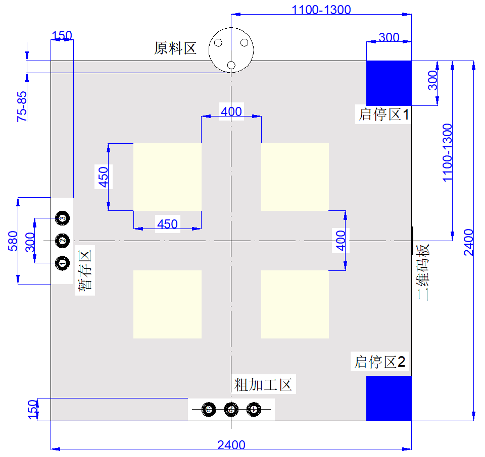

> 本文继承自底盘基线，描述其原有功能及历史结果。合并版当前操作与验证以 [合并与串口操作](合并与串口操作.md) 和根目录README为准；历史证据位于 `evidence/chassis-history`。

> 2026-10-17返程更新：最后B→A/C返回道路在本轮已完整走过时，可先转到发车朝向再后退1030 mm，随后横移60 mm归位。该局部策略不扩展到其他道路；其余道路仍要求目标位于当前车身正后方才直接后退。详见 [横移闭环与发车](横移闭环与发车.md)。

# 地图起点修正与后退行驶

2026-10-17当前版本已加入上沿90 mm、下沿50 mm内移：F另追加50 mm，当前F的Y为340、G为290，D/I的Y为2010；H另向场内移80 mm至X=420，A/C/B/E不动，整圈13960 mm。[当前坐标与配套查表](上下通道内移90与50毫米.md)。以下错起点重放及原料碰台记录保留为历史证据，其原图坐标不再是当前停靠点。

更新：2026-10-14。适用当前连续闭环 `runimu A/C`；本页优先于旧文档中“两侧都以+Y启动”的说法。

当前还加入六次工位右侧夹爪朝向约束，见 [右侧夹爪工位朝向](右侧夹爪工位朝向.md)。下文7段后退、10次转向是加入该约束之前的历史对比，不是当前动作数量。

## 启停区和命令

| 图中位置 | 官方名称 | 本程序节点 | 新版本命令 | 启动时车头 |
|---|---|---|---|---|
| 右上 | 启停区1 | A | `runimu A` | 朝扫码区，图中向下，地图+Y |
| 右下 | 启停区2 | C | `runimu C` | 朝扫码区，图中向上，地图−Y |
| 右侧中部 | 二维码板 | B | 任务首先经过 | — |
| 上侧中部 | 原料区 | F | 第2、5个任务点 | — |
| 下侧中部 | 粗加工区 | D | 第3、6个任务点 | — |
| 左侧中部 | 暂存区 | H | 第4、7个任务点 | — |

图取自项目根目录《附件2-第十三届浙江省工创大赛-智能+工程创新赛道命题与运行.docx》图1，未改动。官方要求扫码→原料→粗加工→暂存→第二批原料/粗加工/暂存→返回；现场装置位置允许有偏差，固定坐标不是实车定位。

**操作者这次从右下启停区2、车头朝扫码区出发，应重新下载本版后使用 `runimu C`。** `runimu A` 不再被理解为任意启停区的通用启动命令。

## 为什么先走到了粗加工一侧

原任务表一直包含两次F，没有删除原料任务。实际存在两个坐标处理错误：上一版将A、C都按地图+Y启动，且地图方向到IMU角度的转换没有对应图面坐标的方向。

地图的X向右、Y向下，`HEAD_Y_POS/HEAD_X_NEG/HEAD_Y_NEG/HEAD_X_POS` 按图面顺时针递增；IMU统一为真实左转角度增加。因此 `CAR_MAP_YAW_SIGN=-1`，与传感器正负配置 `CAR_IMU_YAW_SIGN` 分开处理。A初始朝向为+Y，C初始为−Y，启动时根据实际IMU读数反算地图+Y的航向。返回后恢复本轮初始朝向。

按已确认的“实际从右下却运行旧版A”做理想几何重放，前两点恰好能到B和E；程序以为去了F时，理想物理落点却在 `(1200,2200)`，属于下方粗加工一侧，而原料F为 `(1200,200)`。这解释了“扫码后直接去粗加工”的现象。修正坐标转换并使用C命令后，同一重放到达F `(1200,200)`。这是代码几何重放，不是实车坐标测量，见[重放证据](../evidence/chassis-history/map-frame-replay.json)。

## 后退策略

`CAR_RUN_REVERSE_ENABLED=1` 时，必须同时满足“本轮已按四轮反馈完整走过这条道路”和“下一段位移在当前目标车头正后方”，才保持车头直接后退。首次进入的道路仍转到道路方向后前进，90°方向不主动转成倒车姿态，不额外做全局时间搜索。

记录以无向道路编号保存：完整走完E→F后，F→E和再次E→F均视为这条道路已走过；不表示必须倒车，仍需满足车头正后方条件。一条道路含多个运动段时，全部走完、停车并确认后才记录，部分行程后急停或故障不记录；每次新 `runimu A/C` 清空记录。前进和后退共用IMU纠偏、编码器行程、终点减速及四轮停稳检查。旧 `run A/C` 位置模式未改成后退策略。该记录只代表反馈推算的道路完成，不证明现场无障碍。

未加入夹爪朝向时，两种起点的历史模拟均为18个直行几何段，其中7段后退、10次转向；更早的全向前策略为16次转向。当前已要求F/D/H右侧朝作业区，模拟为22次转向，具体见 [右侧夹爪工位朝向](右侧夹爪工位朝向.md)。节点顺序不变，内移前15040 mm、当前13960 mm，尚不能宣称实车已到达或已完成抓放。

新日志包含：

- `[route segment] from=E to=F ... travel=FORWARD/BACKWARD ... target_heading_dec=... road_completed=0/1`
- 全程状态中的 `completed_roads_mask` 是本轮已完整走过的道路位掩码。
- `[station estimate] node=F station=RAW_MATERIAL; physical_pose=unconfirmed`

`station estimate` 是编码器和任务进度推算，不是视觉确认。

## 原料区接近碰台：待确定靠站点

操作者确认车头在直行接近原料区时碰台，距离程序原定停车点约剩200 mm。当前E→F仍按1000 mm编码器行程接近，然后才原地转向到车头向左、右侧朝原料。调度没有车头外廓、台边距离或转向空间模型，不能据此确认当前F点适合车身接近。

未选后退的代码原因是E→F位移与当时车头相差90°，不满足正后方条件；本轮首次进入E→F又不满足已走过道路条件。仅改变前后进不能保证车头/车尾或转动外廓不碰台。修复需要按现场台边净距、车头伸出距离和转向空间确定提前停车点及右侧靠站顺序，不能把约200 mm接触点直接当作有余量的安全停车点。本轮没有修改1000 mm距离、F坐标、抓放动作或靠站流程，不能作为碰台修复版本。后退规则当前验证见 [已走道路后退验证](../evidence/chassis-history/已走道路后退验证.json)。

## 左右转多2至6度的排查

操作者提供的完成日志中，左转IMU累计89.95°、误差+0.05°；右转累计−89.58°、误差−0.42°。两次均处于±0.8°软件容差内。与现场观察的多转不一致，不能据此给左/右目标直接加上固定补偿。本轮没有改PD增益、容差或目标90°。

左转完成航向138.05°，随后右转受理时为145.70°，间隔变化7.65°；期间是否挪动车辆尚未确认，不能直接认定IMU漂移。

新增完成后0.5、1、2秒的 `[turn postcheck]`，只观察IMU角度变化，不发运动命令，不延迟 `DONE_BY_IMU`，新任务或停止会取消观察。测试时从固定地面标线开始，收到完成后保持车辆不动至少2秒，记录地面实测转角和完整日志，再测试另一方向。比较：

- 完成时IMU是否确实接近目标；
- 停后角度是否继续变化，`fresh` 是否为1；
- 地面实际角度是否与IMU转角一致。

该日志能帮助区分停后回弹/继续转动与角度反馈偏差，不能单凭IMU证明车身真实角度。

## 验证

当前回归覆盖全部16种车头/位移方向组合、前后退纠偏、左右90°/180°、A/C两种真实起始朝向、图面坐标独立物理模型、两次原料任务和返回坐标、停后观察无运动副作用，以及原有反馈/停止/超时测试。源码和ARM构建结果见[地图与后退验证](../evidence/chassis-history/地图起点与后退验证.json)。

本轮没有烧录或实车验收。实际转角多转的根因、场地位置误差和4号旧位置残留误差仍未确认；当前发布的代码修正不能代替重新上车测试。
